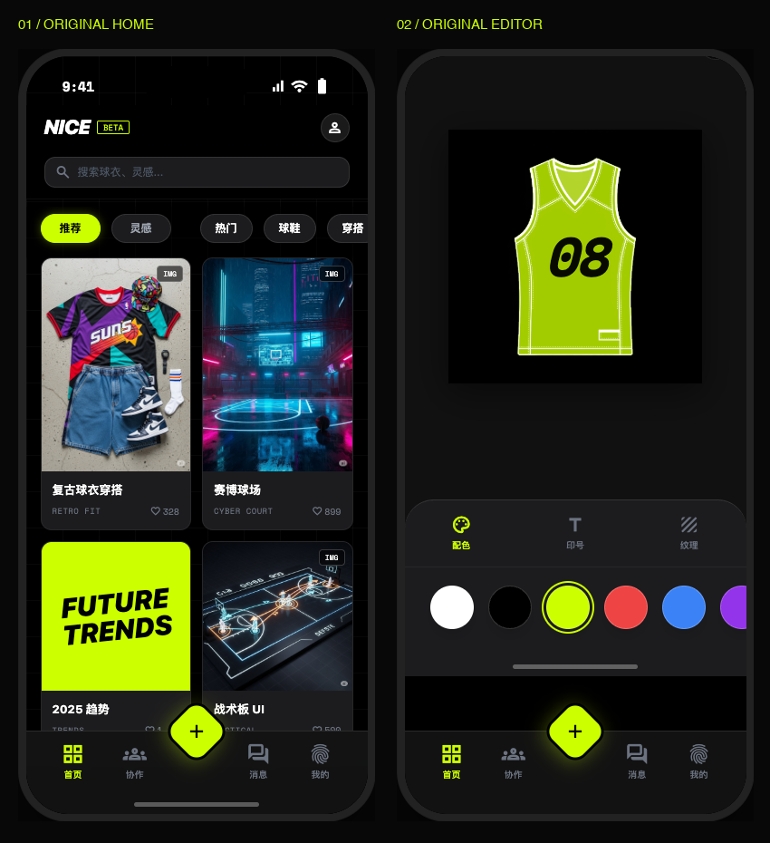

# NICE BALL

**手机保留原版 App 设计，电脑提供完整的桌面网页版。** 两套界面使用同一个站点，根据屏幕宽度自动切换。

- [自动适配入口](https://chenglx-disiner.github.io/nice-ball/)
- [直接打开电脑网页版](https://chenglx-disiner.github.io/nice-ball/web/?view=web)
- [直接打开原版手机版](https://chenglx-disiner.github.io/nice-ball/?view=mobile)



## 两套界面

**手机版**直接基于原 `nice-ball-prototype.html` 补功能，保留原页面、字体、配色、菱形悬浮按钮、玻璃导航、瀑布流及动效。初次进入的演示验证码为 **123456**，不会发送真实短信。

**电脑网页版**沿用之前的桌面设计：侧栏导航、大幅灵感横幅、内容筛选与搜索、双栏灵感内容、右侧创作入口，以及完整的球衣设计工作台、球队协作、消息、个人空间和模拟订单。它是完整的桌面界面。

宽度达到 900 像素时默认显示电脑端；较窄屏幕默认显示原版手机端。电脑侧栏有“查看原版手机版”，手机预览界面可“打开电脑网页版”，可固定显示其中一种布局。

## 功能

- 发现灵感、分类与搜索、点赞、收藏、灵感详情。
- 原版模版编辑：配色、号码、字号、纹理、撤销、保存与 PNG 导出。
- 桌面设计工作台：版型、图案、任意配色、队名和号码、正反面、保存及 SVG 导出。
- 本机作品库：继续编辑、复制、球队使用、删除；桌面展示库发布。
- 球队成员和尺码管理、重复号码校验、设计确认。
- 个人与球队模拟订单、收件信息校验、模拟付款、确认与取消。
- 本机消息、个人资料、备份与恢复。
- 手机版灵感手稿上传，已上传图片也可在电脑灵感区浏览。

## 两套界面的数据

**同一浏览器、同一站点内**共用资料、作品、配色与号码、球队成员、收藏和模拟订单。电脑保存的作品可在手机界面继续编辑，修改后能回到电脑界面；桌面额外的队名、图案等信息会保留。两个浏览器标签页间也会更新本机记录。

这是浏览器本地存储，不是跨设备云同步。实际手机与电脑、不同浏览器或设备之间不会自动同步；可以导出备份转移数据。清理浏览器数据可能删除未备份记录。

模拟订单单价统一为 ¥299，不产生真实交易。更改已选球队的作品或成员后需重新确认设计。

## 本地运行

在仓库目录运行：

```sh
python3 -m http.server 4173 --bind 127.0.0.1
```

然后访问 `http://127.0.0.1:4173/`。同源服务可保证两套界面共用数据。直接双击文件时各浏览器对本地存储和文件访问的规则可能不同，建议使用上述方式。

无需安装前端依赖或执行构建。所有项目图片、图标字体和预编译样式都随仓库保存。网页访问按需加载图片；文件方式预览保留离线图片目录。

## 结构

```text
index.html        原版手机界面与原视图模板
features.js       手机版补充功能
features.css      新增弹层及手机适配
layout.js         设备适配与手动切换
shared-data.js    两套界面的本机数据映射
web/index.html    电脑网页版入口
web/app.js        电脑端功能与页面
web/styles.css    电脑端视觉与布局
assets/           原项目图片、字体、模版遮罩等
验证说明.md       功能与布局验证记录
```

## 部署和范围

GitHub Pages 从 `main` 分支根目录发布。推送更新后，网页会重新发布。

当前是前端交互演示，未接入真实账号、云端数据库、多人实时协作、支付、物流、实时 AR 或生成式 AI。AI 区域明确标为本地规则或示例，不伪造在线服务。订单请使用示例收件信息。
